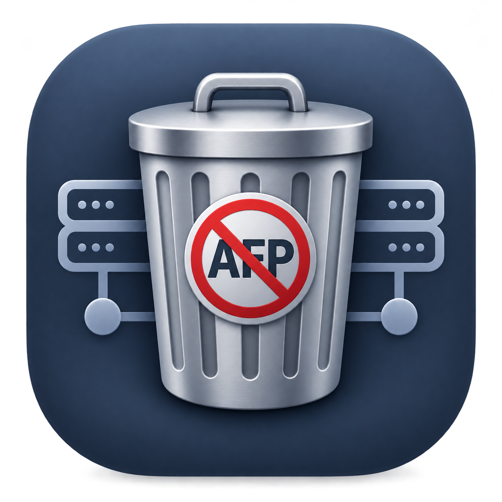

<p align="center"></p>

# TrashAFP

Application macOS qui **liste tous les partages AFP et SMB** d'un Mac et aide à **purger les références AFP** devenues inutiles.

macOS 27 « Golden Gate » (sortie le 14 septembre 2026) a retiré complètement le protocole AFP du client macOS : tout ce qui pointe encore vers `afp://` ne fonctionne plus. TrashAFP retrouve ces références oubliées.

## Télécharger

➡️ **[TrashAFP.dmg](https://github.com/mx-ch-rgb/TrashAFP/releases/latest/download/TrashAFP.dmg)** (dernière version)

Application signée (Developer ID) et notarisée par Apple. Ouvrez le DMG, glissez TrashAFP dans Applications, lancez-la.

**Prérequis :** Mac Apple Silicon, macOS 26 ou plus récent.

## Ce que l'app analyse

| Source | Détail |
|---|---|
| Montages actifs | Volumes AFP et SMB montés (`getfsstat`) |
| Bonjour | Serveurs SMB et AFP annoncés sur le réseau local (serveurs, pas dossiers partagés) |
| Fichiers | `afp://`, `smb://`, `cifs://` dans `~/Library`, et, avec « Recherche étendue », `~/Documents`, `~/Desktop`, `~/Downloads` et `/Library` (plists, scripts, `.url`, `.webloc`, favoris du Finder…) |
| launchd | `~/Library/LaunchAgents`, `/Library/LaunchAgents`, `/Library/LaunchDaemons` (URL, `mount_afp`, `mount_smbfs`) |
| Autres | Destinations Time Machine, crontab utilisateur, `nsmb.conf` |

Les résultats se filtrent par protocole, se recherchent et s'exportent en `.txt`.

## Purge AFP

Le bouton **Purger AFP…** ouvre d'abord une **simulation** : rien n'est modifié tant que vous n'avez pas cliqué sur *Appliquer…* et confirmé.

À l'application, chaque fichier modifié est copié dans `~/Desktop/backup_afp_<date>` (avec un `rapport_purge.txt`), puis :

- les **LaunchAgents utilisateur** AFP sont déchargés et supprimés ;
- les `afp://` des fichiers modifiables deviennent `AFP_REMOVED` (les plists gardent leur format) ;
- les **serveurs récents du Finder** sont réinitialisés ;
- les **volumes AFP montés** sont démontés (sans forcer).

Traités à la main (listés dans le rapport) : LaunchDaemons et fichiers système, favoris Finder binaires, destination Time Machine AFP, crontab.

> Faites toujours une simulation et relisez la liste avant d'appliquer.

## Vie privée et permissions

L'app n'est pas sandboxée (elle doit lire des fichiers de configuration) et tout reste en local : aucune donnée n'est envoyée. macOS peut demander l'accès à Documents, Bureau, Téléchargements et au réseau local (découverte Bonjour).

## Compiler

Xcode 27, projet `TrashAFP.xcodeproj` (SwiftUI, arm64, cible macOS 26).

```bash
export DEVELOPER_DIR=/Applications/Xcode.app/Contents/Developer
xcodebuild -project TrashAFP.xcodeproj -scheme TrashAFP -configuration Debug build
```

`release.sh` produit un DMG signé Developer ID et notarisé. Il suppose votre propre certificat, votre équipe (`TEAM` dans le script) et un profil `notarytool` nommé `trashafp-notary`.
